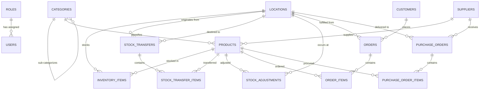

# StockSmart: Entity Relationship (ER) Summary & Schema Documentation

## 1. High-Level Architecture
StockSmart uses a normalized 3NF relational schema designed for Supabase (PostgreSQL 15+). The schema separates master operational entities from high-velocity transaction records, enforcing integrity via foreign keys, unique indexes, and domain check constraints.

---

## 2. Relationships Summary

### One-to-Many (`1:N`)
| Parent Table | Child Table | Foreign Key | Description |
|---|---|---|---|
| `roles` | `users` | `users.role_id` | A role (Admin, Warehouse Manager, Store Associate) is assigned to multiple users. |
| `categories` | `categories` | `categories.parent_category_id` | Recursive self-referential hierarchy for multi-level category trees. |
| `categories` | `products` | `products.category_id` | A category groups multiple retail catalog products. |
| `suppliers` | `products` | `products.supplier_id` | A primary vendor provides one or more products. |
| `suppliers` | `purchase_orders` | `purchase_orders.supplier_id` | A vendor receives multiple procurement purchase orders. |
| `locations` | `purchase_orders` | `purchase_orders.destination_location_id` | A warehouse or store receives purchase shipments. |
| `purchase_orders` | `purchase_order_items` | `purchase_order_items.purchase_order_id` | A purchase order has multiple line items. |
| `locations` | `orders` | `orders.location_id` | An order is fulfilled from a specific store or warehouse. |
| `customers` | `orders` | `orders.customer_id` | A customer can place multiple sales orders over time. |
| `orders` | `order_items` | `order_items.order_id` | A sales order consists of multiple line items. |
| `locations` | `stock_transfers` (source) | `stock_transfers.from_location_id` | Source location dispatching stock transfers. |
| `locations` | `stock_transfers` (target) | `stock_transfers.to_location_id` | Destination location receiving stock transfers. |
| `stock_transfers` | `stock_transfer_items` | `stock_transfer_items.transfer_id` | A stock transfer transaction has multiple line items. |
| `locations` | `stock_adjustments` | `stock_adjustments.location_id` | Stock adjustments (shrinkage, damaged, audit) recorded at a location. |

### Many-to-Many (`M:N`) Modeled via Associative Tables
| Entity 1 | Entity 2 | Associative Table | Description |
|---|---|---|---|
| `products` | `locations` | `inventory_items` | Tracks granular stock quantity on hand and reserved per product per facility. |
| `products` | `orders` | `order_items` | Products sold across sales orders. |
| `products` | `purchase_orders` | `purchase_order_items` | Products procured across purchase orders. |
| `products` | `stock_transfers` | `stock_transfer_items` | Products moved between facilities. |

---

## 3. Database Integrity & Constraints
1. **Third Normal Form (3NF)**: No transitive dependencies; non-key attributes strictly depend on the primary key.
2. **PostgreSQL & Supabase Compatibility**: Built with standard SQL data types (`TIMESTAMPTZ`, `NUMERIC(12,2)`, `SERIAL`, `VARCHAR`), compatible with Supabase connection pooling and direct connection.
3. **Optimized Indexes**:
   - B-Tree indexes on all foreign key references.
   - B-Tree indexes on SKU, order numbers, transfer numbers, phone numbers, email, and status columns for fast filtering and search.
